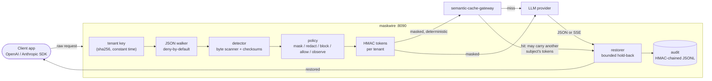
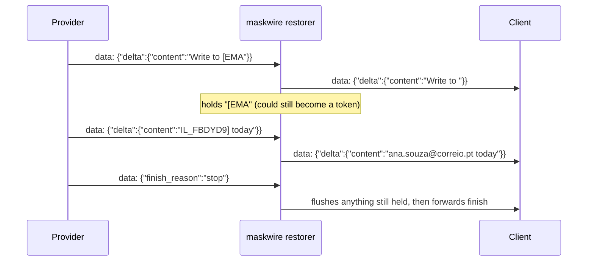
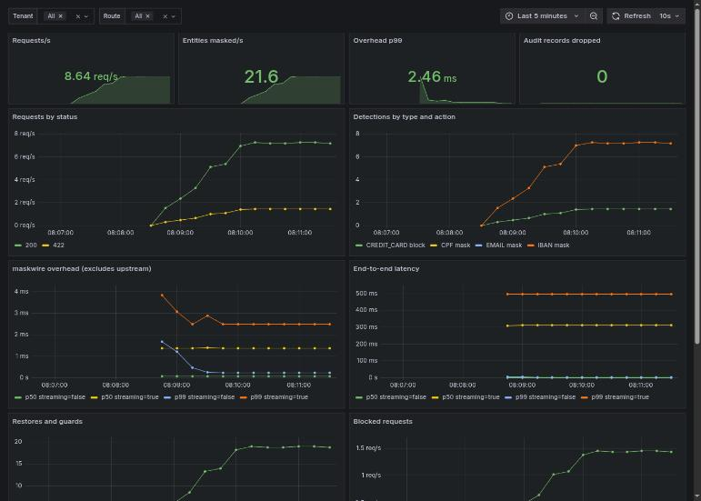

# maskwire

> Reversible, streaming-safe PII pseudonymisation for LLM APIs, in a single Go binary.

[](https://github.com/Guilherme-Ciano/maskwire/actions/workflows/ci.yml)
[](https://github.com/Guilherme-Ciano/maskwire/actions/workflows/codeql.yml)
[](https://github.com/Guilherme-Ciano/maskwire/actions/workflows/ci.yml)
[](docs/evaluation.md)
[](https://goreportcard.com/report/github.com/Guilherme-Ciano/maskwire)
[](https://scorecard.dev/viewer/?uri=github.com/Guilherme-Ciano/maskwire)
[](https://github.com/Guilherme-Ciano/maskwire/releases)
[](https://pkg.go.dev/github.com/Guilherme-Ciano/maskwire/pkg/mask)
[](LICENSE)

maskwire is a reverse proxy for the OpenAI Chat Completions, Responses and Embeddings APIs and the Anthropic Messages
API. Before a request leaves
your network it replaces e-mail addresses, phone numbers, IPs, IBANs, card numbers and checksum-valid national IDs
(CPF, CNPJ, NIF, DNI/NIE, Steuer-ID, NIR, codice fiscale) with opaque tokens such as `[CPF_A0SA1Q]`. When the
answer comes back, JSON or a server-sent event stream, it puts the original values back, even when a token is
split across stream chunks.

```text
client sent    : ...reply to the customer at ana.souza@correio.pt about the refund, her CPF is 529.982.247-25...
upstream saw   : ...reply to the customer at [EMAIL_FBDYD9] about the refund, her CPF is [CPF_A0SA1Q]...
client got     : I received: ...reply to the customer at ana.souza@correio.pt about the refund, her CPF is 529.982.247-25...
```

That output comes from a real `docker compose up` run, recorded in [`docs/demo-output.txt`](docs/demo-output.txt).

## Why

- **Teams want LLMs on customer data, but every CPF, NIF and IBAN ends up in a provider's logs.** The usual fix
  is a Python sidecar that redacts. Redaction cannot be undone, so the answer comes back full of placeholders.
- **Restoring values in a stream is the hard part.** A token like `[EMAIL_FBDYD9]` can arrive as `[EMA` +
  `IL_FB` + `DYD9]` in three separate SSE events. maskwire restores it with at most 48 bytes held back per stream,
  and no timers on the hot path.
- **Masking usually destroys caching.** maskwire derives tokens with HMAC-SHA256 from a per-tenant key, so the
  same input always produces the same masked prompt, and semantic or prompt caches keep hitting.

## What this is not

maskwire is a technical measure, not a compliance product. Read this table before you put it in front of anything;
[`docs/compliance.md`](docs/compliance.md) maps it article by article to the GDPR, the AI Act and the LGPD.

| maskwire can honestly claim | maskwire does **not** claim |
|---|---|
| It pseudonymises (GDPR Art. 4(5)) the entity types it detects before they leave your network. | "GDPR compliant", "anonymised", or "no personal data reaches the LLM". Pseudonymised data is still personal data (GDPR Recital 26). |
| Detection quality is what the tests and published evaluations show, per entity type. | "Detects all PII". Person names are detected only with the opt-in `detect.names` preview, and only when capitalized and either a known first name or after an honorific or label; postal addresses, free-text health data and other quasi-identifiers are **not detected**. |
| It writes a tamper-evident, HMAC-chained request log with no raw personal data, with optional external anchors, which can support your own record keeping and log retention. | "EU AI Act compliance in a box", or a complete Art. 30 record. The log is one input to those, owned by you. |
| Masked prompts lower what the provider receives. | That the provider receives no personal data, or that transfers outside the EU stop being transfers. |

Further limits you should know about:

- By default tokens are stable per tenant. That is what keeps caches hitting, and it also means the provider can
  link a person's requests over time. `token_scope: session` or `request` removes that linkability at the cost of
  cache hits; rotating the key version changes every token.
- If the same value appears in two formats in one request (`529.982.247-25` and `52998224725`), both get one token
  and both are restored in the first format seen.
- PII inside JSON **numbers** in tool arguments is masked by turning the number into a token string. A strict tool
  schema may reject that.
- Images, audio and files are not scanned. Base64 payloads pass through untouched.
- A prompt-injected document can ask the model to write another value's token from the same request into a tool
  call. By default maskwire restores any token issued for the request; `tool_restore` limits which entity types are
  restored inside tool-call arguments.
- `observe` mode forwards the original body. Use it to measure before you enforce, never as protection.

## Architecture



A streamed response goes through one restorer per channel (each choice's content, each tool call's arguments,
each Anthropic content block):



How the pieces work:

- **Detection** is a single pass over the bytes, with no regular expressions on the hot path. Runs of digits and
  capital letters joined by separators (including no-break spaces, zero-width characters, dashes, soft hyphens
  and fullwidth digits) are compacted and checked against real checksums: CPF and CNPJ (including the new
  alphanumeric CNPJ) mod 11, PT NIF, ES DNI/NIE letters, DE Steuer-ID ISO 7064, FR NIR mod 97 with Corsica,
  IT codice fiscale with omocodia, IBAN mod 97 with the length table for 72 countries, and Luhn with IIN ranges for cards. A digit
  run only counts as a phone number when it looks like one: an international `+`, an area code in parentheses, or
  a word such as "tel", "telefone", "WhatsApp" or "Telefon" just before it. It is then checked with
  libphonenumber under a per-request budget. Without that context, order and invoice numbers are left alone.
- **Scores.** A checksum-valid ID next to its keyword ("CPF", "NIF", "cartão") scores 1.0, one in its official
  grouping (`529.982.247-25`, `4242 4242 4242 4242`) 0.9, and a bare digit run that happens to pass the checksum
  0.6. Bare runs are still masked by default; raise `min_score` for a type to let them through. Without a keyword,
  an ID is never cut out of a longer token (`177.763.604-50`, `13.0.18267.2468`), never read inside a `+` or `(`
  phone number, and never assembled from groups in a non-official layout.
- **Names (preview).** With `detect.names: true`, a capitalized known first name followed by capitalized surnames
  (particles such as "da" or "van" allowed) scores 0.85, any capitalized words after an honorific or label
  ("Sr.", "Frau", "Mme", "nome:", "cliente:") 0.9, and a lone first name 0.5. Words such as "São", "Rua" or
  "Hospital" before a first name block it, so places stay unmasked. Parts of a detected name are masked again
  wherever they recur in the request. Lowercase names are not detected.
- **Survives real models.** In [a test with Claude Haiku, Sonnet and Opus](bench/results/survival/README.md) on 24
  masked multilingual prompts, every token a model wrote came back exact (90-96% of tokens; the rest were values the
  model chose to leave out) and no model invented a token.
- **Measured.** [`docs/evaluation.md`](docs/evaluation.md) reports precision, recall and leak rate per type and
  presentation on 20,000 generated documents with hard negatives, regenerated by `make eval` and checked in CI.
  Labelled identifiers are found at 99.6-100% for every type; CPFs with a wrong check digit, failing IBANs and
  cards, hashes, dates and prices are flagged at 0-0.1%.
- **Tokens** are `[TYPE_SUFFIX]`, where the suffix is 6 Crockford base32 characters of
  HMAC-SHA256(HKDF(master, tenant), type ‖ canonical value). On an in-request collision the suffix grows to 8, then 10.
- **Restore** is a hand-written matcher that can answer "complete token", "not a token" or "could still become a
  token". Only the last case holds bytes back, and the longest accepted form is under 48 bytes, so the hold-back is
  bounded. It accepts what models do to tokens: lower case, spaces, Markdown escaping (`\[EMAIL\_…\]`), other
  brackets (`<…>`, `(…)`, `{…}`, `【…】`), no brackets at all (`EMAIL_FBDYD9`, upper case only), `-` or a space instead
  of `_`, labels such as `E-MAIL` or `CORREO`, a missing closing bracket, URL encoding (`%5B…%5D`) and `\u005b`
  inside tool-call JSON. Any form other than the exact `[TYPE_SUFFIX]` is replaced only when its suffix was issued
  for this request, so ordinary text such as "EMAIL ADDRESS" is never touched. Tests restore at every split point of
  a stream and check the result equals restoring the whole buffer.
- **Foreign-token guard.** Only tokens issued for the current request are restored. Any other well-formed token,
  for example one served by a semantic cache that answered with another customer's response, becomes `[email]`,
  `[cpf]` and so on, and is counted in `maskwire_foreign_tokens_total`.
- **Restore count on every response.** Buffered responses carry an `X-Maskwire-Restored` header with the number of
  tokens restored; streamed responses announce the same name as an HTTP trailer and send it after the last event.
- **Request walking is deny-by-default.** Every string leaf is masked except an explicit skip list: model, roles,
  ids, tool and function names, signed Anthropic thinking blocks and base64 payloads. Inside JSON Schemas (tool
  parameters, `response_format`, Responses `text.format`) only free text is masked: `description`, `title`,
  `default`, `const`, `enum` and `examples` values; `type`, `pattern`, `format` and property names never change.
  JSON key names are compared after decoding escapes, and PII inside JSON numbers in tool arguments becomes a token.

## Quickstart

The demo builds [semantic-cache-gateway](https://github.com/Guilherme-Ciano/semantic-cache-gateway) from a sibling
checkout, with three upstream bug fixes applied at image build time (see
[`docs/semantic-cache-gateway.md`](docs/semantic-cache-gateway.md)). No API keys are needed: the upstream is
`mockllm`, a Go mock that echoes the prompt it received, streams it back in 1-7 byte chunks, and serves embeddings.

```bash
git clone https://github.com/Guilherme-Ciano/semantic-cache-gateway.git
git clone https://github.com/Guilherme-Ciano/maskwire.git
cd maskwire
docker compose up --build -d --wait
make demo
```

`make demo` runs the demo client in a container (compose profile `demo`), so only Docker is needed;
`make demo-local` runs it with a local Go toolchain instead.

| Service | Host port | Purpose |
|---|---|---|
| maskwire | 8090 (`MASKWIRE_PORT`) | proxy |
| maskwire admin | 9091 (`MASKWIRE_ADMIN_PORT`) | `/metrics`, `/livez`, `/readyz` |
| semantic-cache-gateway | 18080 (`SCG_PORT`) | cache, upstream of the default route |
| mockllm | 19000 (`MOCKLLM_PORT`) | mock provider; `GET /last` shows what the upstream received |
| prometheus | 9092 (`PROMETHEUS_PORT`) | scrapes maskwire |
| grafana | 3000 (`GRAFANA_PORT`) | provisioned maskwire dashboard, anonymous read-only |
| jaeger (profile `tracing`) | 16686 (`JAEGER_PORT`) | traces, when `MASKWIRE_TRACING_ENDPOINT=http://jaeger:4318` is set |

`make demo` runs six scenarios: a JSON request through the cache (MISS), the same prompt as a stream (cache HIT,
replayed as SSE), a different customer with the same wording (the foreign-token guard), a direct streaming route,
Anthropic streaming with a thinking block, and a blocked card number.

One request by hand:

```bash
curl -sN localhost:8090/direct/v1/chat/completions \
  -H 'X-Maskwire-Key: mw-demo-0b8e3c1f5a7d9e2b' -H 'Content-Type: application/json' \
  -d '{"model":"gpt-4.1-mini","stream":true,"messages":[{"role":"user","content":"Mail ana.souza@correio.pt, CPF 529.982.247-25"}]}'
curl -s localhost:19000/last
docker compose exec maskwire /usr/local/bin/maskwire audit verify --dir /var/lib/maskwire/audit
```

Point an existing SDK at maskwire by changing its base URL and adding the `X-Maskwire-Key` header. The client's
own `Authorization` header is forwarded to the provider unchanged.

Try the detector on its own:

```bash
echo "CPF 529.982.247-25, IBAN DE89 3704 0044 0532 0130 00" | go run ./cmd/maskwire detect
```

## Restoring tokens from earlier turns

By default only tokens issued for the current request are restored. In a long conversation the model may repeat a
token from an earlier turn that is no longer in the request, for example after the client trimmed the history,
and the foreign-token guard then turns it into `[email]`. Tenants with `token_scope: session` can opt into
`cross_turn_restore`:

```yaml
vault:
  backend: redis
  redis_addr: redis:6379
  ttl: 24h
tenants:
  - id: acme
    token_scope: session
    cross_turn_restore: true
```

After masking, maskwire writes the request's token-to-value mapping to the vault. Each value is sealed with
AES-256-GCM under a key derived from the master key, the tenant and the `X-Maskwire-Session` id, and stored under a
key derived the same way, so a dump of Redis reveals neither values nor session ids. When a response contains a
token this request did not issue, maskwire looks it up in that conversation's vault before falling back to the
guard. Tokens never restore across conversations or tenants. Session ids work as bearer capabilities within a
tenant: use random, unguessable ids. A failed vault write is logged and counted in `maskwire_vault_errors_total`,
and the request still goes through. The `memory` backend is for a single instance.

## Use as a Go library

The detector, tokens and restorer are also available without the proxy, for batch jobs or for apps that call
the provider themselves:

```go
m, err := mask.New(mask.Options{MasterKey: key, Tenant: "acme"})
if err != nil {
	return err
}
s := m.Session()
defer s.Close()
masked, err := s.Mask(ticket)
if err != nil {
	return err
}
reply := callModel(masked)
fmt.Println(s.Restore(reply))
```

`github.com/Guilherme-Ciano/maskwire/pkg/mask` also has `MaskJSON`, a streaming `Restorer` (`Write` each chunk,
then `Flush`), per-type `Counts`, policy `Rules` with `block` returning a `*BlockedError`, and a key-less
`Detect` for scanning only. Tokens from the same key and tenant match the proxy's, so both can be used together.

## Configuration

YAML file (`--config` or `MASKWIRE_CONFIG`) overlaid by environment variables: `MASKWIRE_SECTION__KEY`, for
example `MASKWIRE_SERVER__ADDR`. Every key with its type, default and meaning is in
[`docs/configuration.md`](docs/configuration.md), generated from the code; [`deploy/maskwire.yaml`](deploy/maskwire.yaml)
is a working example. The settings most deployments touch:

- `keys.master_key_file`: a 32+ byte hex key in a file only maskwire can read. It derives every tenant's token key
  and the audit key; changing `keys.version` rotates all tokens.
- `routes[]`: one per upstream endpoint, with a codec: `openai` (Chat Completions), `openai-responses`,
  `openai-embeddings`, `anthropic` (Messages and `count_tokens`) or `passthrough` (GET routes such as `/v1/models`,
  still behind the tenant key). An upstream URL with a path is used as is; without one, the incoming path is
  appended.
- `tenants[]`: `key_sha256` (`maskwire gen-key` prints a key and its hash; `hash-key` hashes an existing key of at
  least 24 characters), `mode` (`enforce` or `observe`), a `default` action and `by_type` rules with `action` and
  `min_score`.
- `tenants[].token_scope`: `tenant` (the default) gives the same token for the same value in every request, so
  prompt caches keep hitting; `session` keys tokens to the `X-Maskwire-Session` header, so they are stable within a
  conversation and unlinkable across conversations; `request` gives fresh tokens every time, at the cost of cache
  hits. A `session` request without the header falls back to `request`.
- `tenants[].tool_restore`: the entity types restored inside tool-call arguments (`all`, `none` or a list such as
  `[EMAIL, PHONE]`). Other types stay as tokens, so a prompt injection cannot route them into a tool; they are
  counted in `maskwire_tool_withheld_total`.
- `tenants[].rate_limit`: `rps` and `burst`; requests over the limit get `429` with `Retry-After` before the body
  is read.
- `tenants[].prompt_hint` adds a short instruction to copy placeholders verbatim (off by default because it
  changes the prompt). `tenants[].response_scan: observe` counts personal data the model generated itself.

Entity types for `by_type`: `PERSON` (with `detect.names: true`; tokens look like `[NAME_X7K2QD]`), `EMAIL` (also `name (at) domain (dot) tld` forms), `PHONE`, `IP`, `IP_PRIVATE`
(allowed by default), `CPF`, `CNPJ` (numeric and the new alphanumeric format), `PT_NIF`, `ES_DNI`, `ES_NIE`,
`DE_STEUER_ID` (scores 0.5 without a keyword such as "Steuer-ID"), `FR_NIR`, `IT_CF`, `IBAN`, `CREDIT_CARD`,
`FI_HETU`, `IE_PPSN`, `UK_NINO`, `SE_PNR` (detected from their format), and `NL_BSN`, `PL_PESEL`, `BE_NN`,
`AT_SVNR`, `BR_PIS`, which are plain digit runs and so need their keyword nearby (`BSN`, `PESEL`, `rijksregister`,
`SVNR`, `PIS`) or their official grouping, to keep random numbers from being masked. Example: `by_type: {PT_NIF: {action: mask, min_score: 0.7}}` masks NIFs that are formatted or labelled and
lets a bare 9-digit number through (random 9-digit numbers pass the NIF checksum about 9% of the time). Blocked
types return `422` with `{"error":{"type":"pii_blocked","entities":[...]}}`.

### Reloading tenants

`kill -HUP <pid>` (or `docker compose kill -s HUP maskwire`) re-reads the config file and replaces the tenant list:
keys, policies, `tool_restore`, rate limits and the rest. Requests already in flight finish with the tenants they
started with. Rate-limit state survives for tenants whose limits did not change. Routes, listeners, the master key
and `server.default_tenant` need a restart. An invalid file is rejected and the previous tenants stay active; every
attempt is counted in `maskwire_tenant_reloads_total{result}`.

## Metrics

The compose demo provisions a Grafana dashboard ([`deploy/grafana/dashboards/maskwire.json`](deploy/grafana/dashboards/maskwire.json))
on http://localhost:3000 with request rates, detections, overhead and latency percentiles, restores and guards,
streaming and audit health:



The admin listener serves Prometheus metrics. Labels carry tenant ids, route names and entity type names, never
values.

| Metric | Labels | Meaning |
| --- | --- | --- |
| `maskwire_requests_total` | tenant, route, status | proxied requests |
| `maskwire_detections_total` | tenant, type, action | entities found in requests |
| `maskwire_blocked_requests_total` | tenant, type | requests rejected by a block rule |
| `maskwire_restores_total` | tenant, streaming | tokens restored in responses |
| `maskwire_foreign_tokens_total` | tenant, type | tokens not issued for the request |
| `maskwire_tool_withheld_total` | tenant | tokens left masked in tool arguments by `tool_restore` |
| `maskwire_response_detections_total` | tenant, type | personal data the model generated itself |
| `maskwire_mask_duration_seconds` | route | time spent masking the request body |
| `maskwire_overhead_seconds` | route, streaming | masking plus restoring, excluding time waiting on the upstream |
| `maskwire_request_duration_seconds` | route, streaming | end-to-end duration including the upstream |
| `maskwire_tenant_reloads_total` | result | SIGHUP tenant reloads, `ok` or `error` |
| `maskwire_stream_holdback_bytes` | | largest hold-back per streamed response |
| `maskwire_stream_events_total` | outcome | SSE events forwarded or dropped |
| `maskwire_audit_events_total`, `maskwire_audit_dropped_total` | | audit records written and dropped |

## Tracing

Set `tracing.endpoint` to an OTLP/HTTP collector and maskwire emits one server span per request, with a `mask` child
span and an `upstream` client span, and forwards W3C `traceparent` to the provider so an incoming trace continues
through it. Span attributes carry the route, tenant id, status, entity type names and counts, and restore counts,
never values or tokens. To see it in the demo:

```bash
MASKWIRE_TRACING_ENDPOINT=http://jaeger:4318 docker compose --profile tracing up --build -d --wait
make demo
```

Jaeger is then on http://localhost:16686.

## Audit log

Each request writes one JSON line with the tenant, route, model, counts per entity type and action, restore and
foreign-token counts, latency, and SHA-256 digests of the masked request and response. It holds no raw values
and no tokens. Lines are chained with HMAC-SHA256 under a key derived from the master key, so someone who can edit
the files but does not hold the key cannot rewrite the chain. Each day file opens with a record that links to the
previous day's chain, so a deleted or truncated earlier day is detected.

```bash
maskwire audit verify --dir audit --config maskwire.yaml
```

Truncating the newest day, or deleting it entirely, can only be detected against a head stored somewhere else.
Set `audit.anchor_file` to a path on separate storage (another volume, an append-only mount, or a file a log
shipper forwards): every 5 seconds, and on shutdown, maskwire appends the current head of each changed chain to
it. Then verify against it:

```bash
maskwire audit verify --dir audit --config maskwire.yaml --anchors /mnt/worm/maskwire-anchors.jsonl
```

Any anchored head that is no longer in its file, or an anchored file that is gone, fails verification. Records
written in the last 5 seconds before an attack are not covered.

### For the DPO

```bash
maskwire audit report --dir audit --config maskwire.yaml --from 2026-11-01 --to 2026-11-30
```

verifies the log first, then summarises per tenant: recipients (upstream hosts) and models, categories of personal
data with the safeguard applied to each (mask, redact, block, allow), restores and foreign-token events, and data
the model generated itself. That is the evidence a record of processing activities (GDPR Art. 30) needs; `--format
json` gives the same for other tools.

Signed checkpoints make the log verifiable by someone who does not hold the master key's trust: generate a key pair
once, keep the private key off the audit host, and sign the current heads on a schedule:

```bash
maskwire audit keygen --out /secure/keys
maskwire audit checkpoint --dir audit --key /secure/keys/audit-ed25519.key --out checkpoints.jsonl
maskwire audit verify --dir audit --checkpoints checkpoints.jsonl --pubkey audit-ed25519.pub
```

`audit.retention_days` deletes day files older than that many days. Before deleting, maskwire records the last
deleted day and the link the next surviving day depends on in a sealed per-tenant retention ledger, so
verification still passes after retention and a deleted or edited ledger is detected. The AI Act's six-month floor
for deployer logs (Art. 26(6)) means a value of at least 184 if that applies to you.

## Benchmarks

<!-- bench:start -->
Measured on 2026-11-16, commit `0b41bb2`. Hardware: AMD Ryzen 5 4600G (6C/12T), 16 GB RAM, Linux 7.3.4-cachyos,
Go 1.27.4. CPU governor `powersave` with boost on (changing it needs root), and a desktop session was running, so
treat the numbers as a lower bound for a tuned server. Everything runs on one host over loopback against `mockllm`,
a Go mock upstream with zero latency. These are proxy overhead numbers, not internet latency.

**Added latency, non-streaming.** 4 KB chat request with 6 entities (e-mail, CPF, phone, IBAN, IP), vegeta
open-model constant rate (no coordinated omission), 3 s warm-up discarded, 15 s measured, median of 3 runs.
maskwire and mockllm each pinned to 4 cores with `GOMAXPROCS=4`; the audit log was on, with fsync per batch.
"Added" is maskwire minus a direct call to the same mock at the same rate.

| rate | direct p50 | direct p99 | via maskwire p50 | via maskwire p99 | **added p50** | **added p99** | maskwire p99.9 | errors |
|---:|---:|---:|---:|---:|---:|---:|---:|---:|
| 500 req/s | 0.21 ms | 0.60 ms | 0.48 ms | 1.03 ms | **+0.27 ms** | **+0.43 ms** | 2.1 ms | 0 |
| 1,000 req/s | 0.19 ms | 0.35 ms | 0.39 ms | 0.84 ms | **+0.20 ms** | **+0.50 ms** | 1.3 ms | 0 |
| 2,000 req/s | 0.18 ms | 0.45 ms | 0.40 ms | 0.97 ms | **+0.22 ms** | **+0.52 ms** | 1.7 ms | 0 |
| 4,000 req/s | 0.17 ms | 0.65 ms | 0.39 ms | 2.24 ms | **+0.22 ms** | **+1.59 ms** | 7.4 ms | 0 |

Targets were p50 < 0.5 ms and p99 < 2 ms added; both hold at every rate tested. At 4,000 req/s the four pinned
cores are close to saturation and the tail grows. maskwire used 0.36-0.47 CPU-ms per request, including both HTTP
hops, JSON parsing, masking, restore and the audit write.

**Streaming.** The same prompt with `stream: true`; mockllm streams the echo as about 1,000 SSE events of 1-7 bytes
each, with no delay between them. 300 sequential requests.

| | time to first byte p50 | p99 | full stream p50 | p99 |
|---|---:|---:|---:|---:|
| direct | 0.22 ms | 0.70 ms | 7.7 ms | 9.4 ms |
| via maskwire | 0.51 ms | 1.62 ms | 10.4 ms | 13.5 ms |

maskwire adds about 0.29 ms before the first byte, and under 3 µs per SSE event (each event is decoded, restored
and re-encoded; events with nothing to restore are forwarded unchanged). A real model emits tens of events per
second, so per-event cost is negligible next to generation time.

**Micro-benchmarks**, one core (`-cpu 1`), 6 runs, benchstat median ± 95% CI
([raw](bench/results/raw/0b41bb2.txt), [benchstat against the previous run](bench/results/raw/0b41bb2-benchstat.txt)):

| benchmark | result | allocs/op | vs 2026-11-12 |
|---|---:|---:|---:|
| Detect, clean text, 4 KB | 10.1 µs, **407 MB/s** ± 1% | **0** | +57% throughput |
| Detect, clean text, 64 KB | 159 µs, 413 MB/s ± 3% | 0 | +56% |
| Detect, dense text (an entity every ~30 bytes), 4 KB | 97 µs, 42 MB/s | 152 | 4.5x |
| Mask a 4 KB OpenAI request (walk, detect, tokenise) | 45 µs ± 2% | 66 | -28% time |
| Restore a 4 KB OpenAI response | 30 µs ± 3% | 19 | +18% time |
| Streaming restore, 64-byte chunks | 202 MB/s ± 1% | 1 per stream | -31% |
| Streaming restore, 8-byte chunks | 118 MB/s ± 1% | 1 per stream | +15% |
| JSON splice, 1.6 MB body with nothing to mask | 320 MB/s ± 1% | 0 | +5% |
| Full proxy round trip in process (`internal/app`) | 239 µs ± 2% | 403 | new |

The detection target was 150 MB/s per core on ordinary text. The restore rows got slower on purpose: the matcher
now accepts the forms models actually produce (lower case, other brackets, Markdown escapes, missing brackets,
quoted numbers) and only restores the relaxed forms for suffixes issued in the request.

Reproduce: `make bench`, then `make build && cd bench && taskset -c 0-3 go run ./cmd/loadgen -rates 500,1000,2000,4000`.
Full report: [`bench/results/2026-11-16-ryzen-5-0b41bb2/report.md`](bench/results/2026-11-16-ryzen-5-0b41bb2/report.md)
(the "dirty" flag there is the uncommitted raw benchmark file of this run). Earlier run:
[`2026-11-12`](bench/results/2026-11-12-ryzen-5-bfa5642/report.md).
<!-- bench:end -->

## Development

```bash
make lint test build   # golangci-lint v2, comment check, go test -race
make fuzz FUZZTIME=30s # restore split, matcher, detector, mask round trip, request walker, SSE, JSON splicer
make bench             # micro-benchmarks into bench/results/raw
make load              # vegeta load test against real processes (needs make build)
```

The Go code has no comments; `go run ./internal/tools/nocomments` enforces it in CI. See
[CONTRIBUTING.md](CONTRIBUTING.md) and [SECURITY.md](SECURITY.md).

## Verify a release

Releases are cut by release-please: every Conventional Commit on `main` updates a release pull request with the
next version and the `CHANGELOG.md` entry, and merging it tags the version and runs goreleaser, which publishes
multi-arch binaries, an SBOM and a cosign-signed image to GHCR.

```bash
cosign verify ghcr.io/guilherme-ciano/maskwire:<version> \
  --certificate-identity-regexp 'https://github.com/Guilherme-Ciano/maskwire/.github/workflows/release.yml@.*' \
  --certificate-oidc-issuer https://token.actions.githubusercontent.com
```

## Roadmap

- [x] v0.1: OpenAI and Anthropic codecs (JSON and SSE), checksum validators, HMAC tokens, streaming restore,
      policies, foreign-token guard, HMAC-chained audit, Prometheus metrics, mock upstream, compose demo
- [ ] v0.2: full incremental JSON lexer for tool-argument deltas, response scanning in observe mode, Redis vault
      with AES-GCM for multi-turn sessions, Ed25519-signed audit checkpoints
- [ ] v0.3: names via gazetteers and heuristics, published precision and recall per type and language
- [ ] v0.4: optional ONNX NER behind a build tag, with a per-request time budget
- [ ] Namespace isolation in semantic-cache-gateway ([details](docs/semantic-cache-gateway.md))

## License

Apache-2.0. See [LICENSE](LICENSE).
