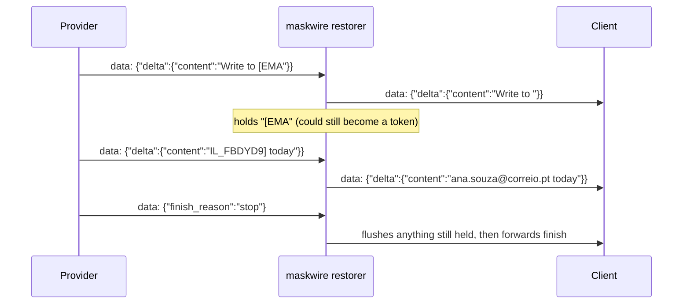

# maskwire

> Reversible, streaming-safe PII pseudonymisation for LLM APIs, in a single Go binary.


[](https://securityscorecards.dev/viewer/?uri=github.com/Guilherme-Ciano/maskwire)

maskwire is a reverse proxy for the OpenAI Chat Completions, Responses and Embeddings APIs and the Anthropic Messages
API. Before a request leaves
your network it replaces e-mail addresses, phone numbers, IPs, IBANs, card numbers and checksum-valid national IDs
(CPF, CNPJ, NIF, DNI/NIE, Steuer-ID, NIR, codice fiscale) with opaque tokens such as `[CPF_A0SA1Q]`. When the
answer comes back, JSON or a server-sent event stream, it puts the original values back, even when a token is
split across stream chunks.

```text
client sent    : ...reply to the customer at ana.souza@correio.pt about the refund, her CPF is 529.982.247-25...
upstream saw   : ...reply to the customer at [EMAIL_FBDYD9] about the refund, her CPF is [CPF_A0SA1Q]...
client got     : I received: ...reply to the customer at ana.souza@correio.pt about the refund, her CPF is 529.982.247-25...
```

That output comes from a real `docker compose up` run, recorded in [`docs/demo-output.txt`](docs/demo-output.txt).

## Why

- **Teams want LLMs on customer data, but every CPF, NIF and IBAN ends up in a provider's logs.** The usual fix
  is a Python sidecar that redacts. Redaction cannot be undone, so the answer comes back full of placeholders.
- **Restoring values in a stream is the hard part.** A token like `[EMAIL_FBDYD9]` can arrive as `[EMA` +
  `IL_FB` + `DYD9]` in three separate SSE events. maskwire restores it with at most 48 bytes held back per stream,
  and no timers on the hot path.
- **Masking usually destroys caching.** maskwire derives tokens with HMAC-SHA256 from a per-tenant key, so the
  same input always produces the same masked prompt, and semantic or prompt caches keep hitting.

## What this is not

maskwire is a technical measure, not a compliance product. Read this table before you put it in front of anything.

| maskwire can honestly claim | maskwire does **not** claim |
|---|---|
| It pseudonymises (GDPR Art. 4(5)) the entity types it detects before they leave your network. | "GDPR compliant", "anonymised", or "no personal data reaches the LLM". Pseudonymised data is still personal data (GDPR Recital 26). |
| Detection quality is what the tests and published evaluations show, per entity type. | "Detects all PII". Personal **names**, postal addresses, free-text health data and other quasi-identifiers are **not detected** in v0.1. |
| It writes a tamper-evident, HMAC-chained request log with no raw personal data, which can support your own record keeping and log retention. | "EU AI Act compliance in a box", or a complete Art. 30 record. The log is one input to those, owned by you. |
| Masked prompts lower what the provider receives. | That the provider receives no personal data, or that transfers outside the EU stop being transfers. |

Further limits you should know about:

- Tokens are stable per tenant. That is what keeps caches hitting, and it also means the provider can link a
  person's requests over time. Rotating the tenant key changes every token.
- If the same value appears in two formats in one request (`529.982.247-25` and `52998224725`), both get one token
  and both are restored in the first format seen.
- PII inside JSON **numbers** in tool arguments is masked by turning the number into a token string. A strict tool
  schema may reject that.
- Images, audio and files are not scanned. Base64 payloads pass through untouched.
- A prompt-injected document can ask the model to write another value's token from the same request into a tool
  call. maskwire restores any token issued for the request.
- `observe` mode forwards the original body. Use it to measure before you enforce, never as protection.

## Architecture


A streamed response goes through one restorer per channel (each choice's content, each tool call's arguments,
each Anthropic content block):



How the pieces work:

- **Detection** is a single pass over the bytes, with no regular expressions on the hot path. Runs of digits and
  capital letters joined by separators (including no-break spaces, zero-width characters, dashes, soft hyphens
  and fullwidth digits) are compacted and checked against real checksums: CPF and CNPJ (including the new
  alphanumeric CNPJ) mod 11, PT NIF, ES DNI/NIE letters, DE Steuer-ID ISO 7064, FR NIR mod 97 with Corsica,
  IT codice fiscale with omocodia, IBAN mod 97 with the length table for 72 countries, and Luhn with IIN ranges for cards. A digit
  run only counts as a phone number when it looks like one: an international `+`, an area code in parentheses, or
  a word such as "tel", "telefone", "WhatsApp" or "Telefon" just before it. It is then checked with
  libphonenumber under a per-request budget. Without that context, order and invoice numbers are left alone.
- **Scores.** A checksum-valid ID next to its keyword ("CPF", "NIF", "cartão") scores 1.0, a formatted one
  (`529.982.247-25`) 0.9, and a bare digit run that happens to pass the checksum 0.6. Bare runs are still masked by
  default; raise `min_score` for a type to let them through.
- **Tokens** are `[TYPE_SUFFIX]`, where the suffix is 6 Crockford base32 characters of
  HMAC-SHA256(HKDF(master, tenant), type ‖ canonical value). On an in-request collision the suffix grows to 8, then 10.
- **Restore** is a hand-written matcher that can answer "complete token", "not a token" or "could still become a
  token". Only the last case holds bytes back, and the longest accepted form is under 48 bytes, so the hold-back is
  bounded. It accepts what models do to tokens: lower case, spaces, Markdown escaping (`\[EMAIL\_…\]`), other
  brackets (`<…>`, `(…)`, `{…}`, `【…】`), no brackets at all (`EMAIL_FBDYD9`, upper case only), `-` or a space instead
  of `_`, labels such as `E-MAIL` or `CORREO`, a missing closing bracket, URL encoding (`%5B…%5D`) and `\u005b`
  inside tool-call JSON. Any form other than the exact `[TYPE_SUFFIX]` is replaced only when its suffix was issued
  for this request, so ordinary text such as "EMAIL ADDRESS" is never touched. Tests restore at every split point of
  a stream and check the result equals restoring the whole buffer.
- **Foreign-token guard.** Only tokens issued for the current request are restored. Any other well-formed token,
  for example one served by a semantic cache that answered with another customer's response, becomes `[email]`,
  `[cpf]` and so on, and is counted in `maskwire_foreign_tokens_total`.
- **Request walking is deny-by-default.** Every string leaf is masked except an explicit skip list: model, roles,
  ids, tool and function names, signed Anthropic thinking blocks and base64 payloads. Inside JSON Schemas (tool
  parameters, `response_format`, Responses `text.format`) only free text is masked: `description`, `title`,
  `default`, `const`, `enum` and `examples` values; `type`, `pattern`, `format` and property names never change.
  JSON key names are compared after decoding escapes, and PII inside JSON numbers in tool arguments becomes a token.

## Quickstart

The demo builds [semantic-cache-gateway](https://github.com/Guilherme-Ciano/semantic-cache-gateway) from a sibling
checkout, with three upstream bug fixes applied at image build time (see
[`docs/semantic-cache-gateway.md`](docs/semantic-cache-gateway.md)). No API keys are needed: the upstream is
`mockllm`, a Go mock that echoes the prompt it received, streams it back in 1-7 byte chunks, and serves embeddings.

```bash
git clone https://github.com/Guilherme-Ciano/semantic-cache-gateway.git
git clone https://github.com/Guilherme-Ciano/maskwire.git
cd maskwire
docker compose up --build -d --wait
make demo
```

| Service | Host port | Purpose |
|---|---|---|
| maskwire | 8090 (`MASKWIRE_PORT`) | proxy |
| maskwire admin | 9091 (`MASKWIRE_ADMIN_PORT`) | `/metrics`, `/livez`, `/readyz` |
| semantic-cache-gateway | 18080 (`SCG_PORT`) | cache, upstream of the default route |
| mockllm | 19000 (`MOCKLLM_PORT`) | mock provider; `GET /last` shows what the upstream received |
| prometheus | 9092 (`PROMETHEUS_PORT`) | scrapes maskwire |

`make demo` runs six scenarios: a JSON request through the cache (MISS), the same prompt as a stream (cache HIT,
replayed as SSE), a different customer with the same wording (the foreign-token guard), a direct streaming route,
Anthropic streaming with a thinking block, and a blocked card number.

One request by hand:

```bash
curl -sN localhost:8090/direct/v1/chat/completions \
  -H 'X-Maskwire-Key: mw-demo-0b8e3c1f5a7d9e2b' -H 'Content-Type: application/json' \
  -d '{"model":"gpt-4.1-mini","stream":true,"messages":[{"role":"user","content":"Mail ana.souza@correio.pt, CPF 529.982.247-25"}]}'
curl -s localhost:19000/last
docker compose exec maskwire /usr/local/bin/maskwire audit verify --dir /var/lib/maskwire/audit
```

Point an existing SDK at maskwire by changing its base URL and adding the `X-Maskwire-Key` header. The client's
own `Authorization` header is forwarded to the provider unchanged.

Try the detector on its own:

```bash
echo "CPF 529.982.247-25, IBAN DE89 3704 0044 0532 0130 00" | go run ./cmd/maskwire detect
```

## Configuration

YAML file (`--config` or `MASKWIRE_CONFIG`) overlaid by environment variables: `MASKWIRE_SECTION__KEY`, for
example `MASKWIRE_SERVER__ADDR`. See [`deploy/maskwire.yaml`](deploy/maskwire.yaml).

| Key | Default | Description |
|---|---|---|
| `server.addr` | `:8090` | proxy listener |
| `server.admin_addr` | `127.0.0.1:9090` | metrics and health listener |
| `server.tenant_header` | `X-Maskwire-Key` | header carrying the tenant API key (stripped before forwarding) |
| `server.default_tenant` | empty | tenant used when the header is missing; leave empty in production |
| `server.max_body_bytes` | `4194304` | request body limit |
| `server.upstream_timeout` | `60s` | time to response headers before a 504 |
| `server.stream_idle_timeout` | `60s` | longest wait for upstream bytes in a stream before it is cut |
| `keys.master_key` / `keys.master_key_file` | none | 32+ byte hex key; the file must not be readable by other users. Use `MASKWIRE_KEYS__MASTER_KEY` or a secret file |
| `keys.version` | `1` | changing it rotates every tenant's tokens |
| `audit.enabled` / `audit.dir` | `true` / `audit` | HMAC-chained JSONL per tenant and UTC day |
| `audit.on_full` | `block` | `block` waits for the writer; `drop` counts and drops |
| `detect.regions` | `BR,PT,ES,DE,FR,IT` | phone number regions |
| `detect.phone_budget` | `64` | libphonenumber validations per request; beyond that, phone-shaped runs (with `+`, parentheses or a keyword) are masked unvalidated |
| `routes[]` | | `name`, `path`, `upstream`, `codec`, `synthesize_stream`. Codecs: `openai` (Chat Completions), `openai-responses` (Responses API, including streamed events), `openai-embeddings` (masks `input` before it is embedded), `anthropic` (Messages and `count_tokens`), `passthrough` (GET only, no body, for routes such as `/v1/models`; still needs the tenant key) |
| `tenants[]` | | `id`, `key_sha256` (`maskwire gen-key` creates a key and its hash; `hash-key` hashes an existing one of at least 24 characters), `mode` (`enforce`, `observe`), `default` action, `by_type` rules with `action` and `min_score`, `token_length` (5-10), `foreign_token` (`generic`, `keep`), `prompt_hint` (adds a short instruction to copy placeholders verbatim whenever a request carries tokens; off by default because it changes the prompt), `response_scan` (`observe`, the default, counts personal data the model generated itself in `maskwire_response_detections_total` and the audit record; `off`), `tool_restore` (entity types restored inside tool-call arguments: `all`, the default, `none`, or a list such as `[EMAIL, PHONE]`; other types stay as tokens so a prompt injection cannot route them into a tool, counted in `maskwire_tool_withheld_total`) |

An upstream URL with a path is used as is; without a path, the incoming path is appended.

Entity types for `by_type`: `EMAIL` (also `name (at) domain (dot) tld` forms), `PHONE`, `IP`, `IP_PRIVATE`
(allowed by default), `CPF`, `CNPJ` (numeric and the new alphanumeric format), `PT_NIF`, `ES_DNI`, `ES_NIE`,
`DE_STEUER_ID` (scores 0.5 without a keyword such as "Steuer-ID"), `FR_NIR`, `IT_CF`, `IBAN`, `CREDIT_CARD`,
`FI_HETU`, `IE_PPSN`, `UK_NINO`, `SE_PNR` (detected from their format), and `NL_BSN`, `PL_PESEL`, `BE_NN`,
`AT_SVNR`, `BR_PIS`, which are plain digit runs and so need their keyword nearby (`BSN`, `PESEL`, `rijksregister`,
`SVNR`, `PIS`) or their official grouping, to keep random numbers from being masked. Example: `by_type: {PT_NIF: {action: mask, min_score: 0.7}}` masks NIFs that are formatted or labelled and
lets a bare 9-digit number through (random 9-digit numbers pass the NIF checksum about 9% of the time). Blocked
types return `422` with `{"error":{"type":"pii_blocked","entities":[...]}}`.

## Audit log

Each request writes one JSON line with the tenant, route, model, counts per entity type and action, restore and
foreign-token counts, latency, and SHA-256 digests of the masked request and response. It holds no raw values
and no tokens. Lines are chained with HMAC-SHA256 under a key derived from the master key, so someone who can edit
the files but does not hold the key cannot rewrite the chain. Each day file opens with a record that links to the
previous day's chain, so a deleted or truncated earlier day is detected.

```bash
maskwire audit verify --dir audit --config maskwire.yaml
```

`verify` prints each file's head hash. Truncating the newest day, or deleting it entirely, can only be detected
against a head you stored elsewhere, so ship those heads to separate storage if that matters to you.

## Benchmarks

<!-- bench:start -->
Measured on 2026-11-12, commit `bfa5642`. Hardware: AMD Ryzen 5 4600G (6C/12T), 16 GB RAM, Linux 7.3.3-cachyos,
Go 1.27.4. CPU governor `powersave` with boost on (changing it needs root), and a desktop session was running, so
treat the numbers as a lower bound for a tuned server. Everything runs on one host over loopback against `mockllm`,
a Go mock upstream with zero latency. These are proxy overhead numbers, not internet latency.

**Added latency, non-streaming.** 4 KB chat request with 6 entities (e-mail, CPF, phone, IBAN, IP), vegeta
open-model constant rate (no coordinated omission), 3 s warm-up discarded, 15 s measured, median of 3 runs.
maskwire and mockllm each pinned to 4 cores with `GOMAXPROCS=4`; the audit log was on, with fsync per batch.
"Added" is maskwire minus a direct call to the same mock at the same rate.

| rate | direct p50 | direct p99 | via maskwire p50 | via maskwire p99 | **added p50** | **added p99** | maskwire p99.9 | errors |
|---:|---:|---:|---:|---:|---:|---:|---:|---:|
| 500 req/s | 0.26 ms | 0.56 ms | 0.63 ms | 2.14 ms | **+0.37 ms** | **+1.59 ms** | 4.4 ms | 0 |
| 1,000 req/s | 0.17 ms | 0.42 ms | 0.47 ms | 1.13 ms | **+0.29 ms** | **+0.71 ms** | 1.9 ms | 0 |
| 2,000 req/s | 0.18 ms | 0.46 ms | 0.49 ms | 1.56 ms | **+0.31 ms** | **+1.10 ms** | 6.0 ms | 0 |
| 4,000 req/s | 0.19 ms | 0.82 ms | 0.47 ms | 2.08 ms | **+0.28 ms** | **+1.27 ms** | 8.2 ms | 0 |

Targets were p50 < 0.5 ms and p99 < 2 ms added; both hold at every rate tested. maskwire used 0.39-0.54 CPU-ms
per request, including both HTTP hops, JSON parsing, masking, restore and the audit write.

**Streaming.** The same prompt with `stream: true`; mockllm streams the echo as about 1,000 SSE events of 1-7 bytes
each, with no delay between them. 300 sequential requests.

| | time to first byte p50 | p99 | full stream p50 | p99 |
|---|---:|---:|---:|---:|
| direct | 0.24 ms | 0.88 ms | 8.1 ms | 9.6 ms |
| via maskwire | 0.57 ms | 1.26 ms | 11.8 ms | 17.1 ms |

maskwire adds about 0.33 ms before the first byte, and about 4 µs per SSE event (each event is decoded,
restored and re-encoded). A real model emits tens of events per second, so per-event cost is negligible next to
generation time.

**Micro-benchmarks**, one core (`-cpu 1`), 6 runs, benchstat median ± 95% CI
([raw](bench/results/raw/3824307.txt), [benchstat](bench/results/raw/3824307-benchstat.txt)):

| benchmark | result | allocs/op |
|---|---:|---:|
| Detect, clean text, 4 KB | 15.8 µs, **259 MB/s** ± 1% | **0** |
| Detect, clean text, 64 KB | 247 µs, 265 MB/s ± 2% | 0 |
| Detect, dense text (an entity every ~30 bytes), 4 KB | 436 µs, 9.4 MB/s | 966 |
| Mask a 4 KB OpenAI request (walk, detect, tokenise) | 62 µs ± 4% | 82 |
| Restore a 4 KB OpenAI response | 25 µs ± 4% | 12 |
| Streaming restore, 64-byte chunks | 292 MB/s ± 4% | 1 per stream |
| Streaming restore, 8-byte chunks | 102 MB/s ± 2% | 1 per stream |
| JSON splice, 1.6 MB body with nothing to mask | 304 MB/s ± 1% | 0 |

The detection target was 150 MB/s per core on ordinary text. Dense text is slow because every phone candidate is
validated with libphonenumber; the per-request budget (`detect.phone_budget`) caps that cost.

Reproduce: `make bench`, then `make build && cd bench && taskset -c 0-3 go run ./cmd/loadgen`. Full report:
[`bench/results/2026-11-12-ryzen-5-bfa5642/report.md`](bench/results/2026-11-12-ryzen-5-bfa5642/report.md).
<!-- bench:end -->

## Development

```bash
make lint test build   # golangci-lint v2, comment check, go test -race
make fuzz FUZZTIME=30s # restore split, matcher, detector, mask round trip, request walker, SSE, JSON splicer
make bench             # micro-benchmarks into bench/results/raw
make load              # vegeta load test against real processes (needs make build)
```

The Go code has no comments; `go run ./internal/tools/nocomments` enforces it in CI. See
[CONTRIBUTING.md](CONTRIBUTING.md) and [SECURITY.md](SECURITY.md).

## Verify a release

```bash
cosign verify ghcr.io/guilherme-ciano/maskwire:<version> \
  --certificate-identity-regexp 'https://github.com/Guilherme-Ciano/maskwire/.github/workflows/release.yml@.*' \
  --certificate-oidc-issuer https://token.actions.githubusercontent.com
```

## Roadmap

- [x] v0.1: OpenAI and Anthropic codecs (JSON and SSE), checksum validators, HMAC tokens, streaming restore,
      policies, foreign-token guard, HMAC-chained audit, Prometheus metrics, mock upstream, compose demo
- [ ] v0.2: full incremental JSON lexer for tool-argument deltas, response scanning in observe mode, Redis vault
      with AES-GCM for multi-turn sessions, Ed25519-signed audit checkpoints
- [ ] v0.3: names via gazetteers and heuristics, published precision and recall per type and language
- [ ] v0.4: optional ONNX NER behind a build tag, with a per-request time budget
- [ ] Namespace isolation in semantic-cache-gateway ([details](docs/semantic-cache-gateway.md))

## License

Apache-2.0. See [LICENSE](LICENSE).
